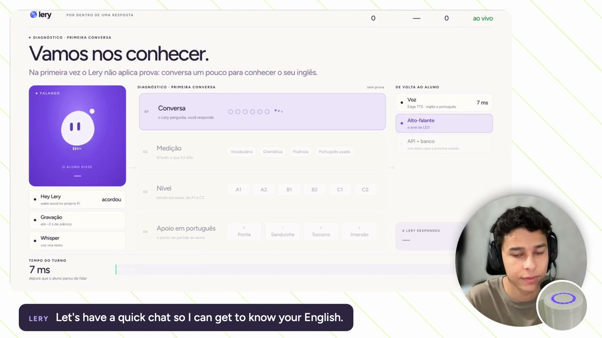
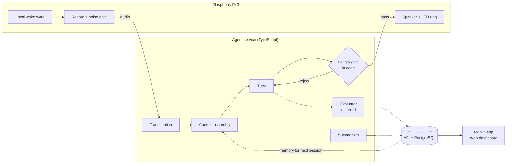

# Lery AI: engineering case study

**A screenless voice tutor for spoken English, running on a Raspberry Pi 3.**

You say "Hey Lery" and talk. It answers out loud, at your level. There is no screen to stare at; corrections and progress show up later in a companion app.

Final-year Computer Engineering project (UNISAL, Brazil, 2026), graded 10/10. I built the device, the services, the apps and the evaluation lab. The source code is private; this repository documents the engineering.

The interesting part was not calling an LLM. It was making the model behave the same way every time, when the only output is speech and nobody can scroll up to check it.

▶ [90-second demo](media/demo.mp4), real device, English subtitles.

**Contents:** [Why](#why) · [Results](#results) · [Architecture](#architecture) · [Design patterns](docs/patterns.md) · [Evaluation](docs/evaluation.md) · [Decision records](#architecture-decision-records) · [References](docs/references.md)

## Why

Many people study English for years and still freeze when they have to speak. The literature calls it foreign language anxiety (Horwitz et al., 1986), and Krashen's affective filter hypothesis describes how it gets in the way of acquisition. Reviews report that practising with AI chatbots can reduce it (Rachmadani et al., 2026), and the phone itself may compete for attention (Ward et al., 2017, with mixed replications). So the question was: **what if conversation practice left the screen?**

## Results

| Measure | Baseline | Final |
|---|---|---|
| Tutor turns passing every automated rule | 76.7% | **91.7%** mean of 4 runs (88.3 to 96.7) |
| Tutor latency, median | 4.4 s | **2.8 s** |
| Tutor latency, p95 (target ≤ 4 s) | 7.6 s | 7.7 s, **target missed** |
| Replies with markup the voice would read aloud | 16.7% | 0% |
| Evaluator tokens per call | ~945 | ~400 |

Measured with **simulated students** (A1, B1 and C1 profiles, 60 turns per run) against the real model, Gemini 3.5 Flash. The baseline is a single run, so part of the gap is noise. This shows the tutor follows its rules more often. It does not show that anyone learns faster or feels less anxious.

On the real device, from the end of speech to the start of the reply:

| Voice | Median wait | Sample |
|---|---|---|
| Free neural voice | 11.0 s | 14 turns |
| Commercial voice, synthesized server-side | 6.0 s | 12 turns |

Six seconds is still slow for a conversation. Most of it is spent outside the LLM: detecting the end of speech, transcribing and synthesizing the voice.

## Architecture

| Part | Stack |
|---|---|
| Device | Python, openWakeWord, sounddevice, WS2812B LED ring |
| Agent | Node.js, TypeScript, Fastify, one provider interface (Gemini, OpenAI, Anthropic, OpenAI-compatible) |
| API | Fastify, Prisma, PostgreSQL |
| Clients | React Native app, React dashboard with a test lab |

This is **not an autonomous agent**. Each turn is a fixed workflow: generate, check, rewrite if rejected, speak, grade later. A lesson needs predictability more than it needs autonomy.

## Decisions

**No provider keys on the device.** The first version called the model straight from the Pi, so anyone holding the SD card held the API key. Model, transcription and commercial voice keys now live server-side. The device carries its own revocable key. Cost: one more network hop and one more service that can fail.

**Code checks what code can check.** A second model call used to verify that beginner replies were short enough. It added about 5 s (median) before the tutor could speak. Turning its reasoning down saved tokens, but then it could not count words: 5 of 8 A1 turns broke the limit. Sentence and word limits are now a few lines of code. Whole-turn latency: 2.7 s median, 94% within 4.9 s (36 turns).

**The grade never blocks the reply.** The learner is waiting for a voice, not a score. Evaluation runs after the answer is sent, and closing a session waits for pending grades.

**Code runs the beginner loop, the model writes the content.** Complete beginners start in their native language: answer a question, hear how to say it in English, repeat it. The state machine and the repetition scoring are deterministic and local. The model only writes the next question and the target sentence, as structured JSON. Letting the model pick the language would make progress impossible to measure.

**Layered context, memory between sessions.** The tutor prompt is assembled from the most stable layer to the most volatile: persona, learner snapshot, level rules, lesson. After each session a summarizer writes a short card (main error, progress, open topic) that the next session reads.

**Local wake word.** Audio leaves the device only after "Hey Lery".

## How I evaluated it

You cannot unit-test whether a tutor is any good, and talking to it by hand does not scale. So I built a lab:

- **Simulated students**: LLM profiles with a CEFR level, a life story and the mistakes Brazilian learners tend to make.
- **Scripted hard cases** injected into sessions: prompt extraction, going off-role, a sad or hostile learner, unintelligible audio, a correct sentence where the tutor must not invent a correction.
- **Deterministic rules** on every reply: length by level, speech-safe text, no prompt leakage, no repetition, memory recall, latency.
- **An LLM judge**, treated as a secondary signal because it shares a model family with the tutor and the students.
- **The same code path as production** for prompt assembly and turn orchestration.

The method: set targets before looking at results, change one thing, run the battery, compare, keep or revert. The comparison tool warns when rules or scenarios differ between two runs, because then the numbers cannot be compared.

## What went wrong

**My own prompt broke my own rule.** B1 replies kept running to three sentences against a limit of two. Telling the model to count did nothing. The cause was the correction *example* inside the prompt: it had three sentences. Fixing the example took length failures from 18% to 1.8%.

**A fix that made things worse.** I banned one-word exclamations to save a sentence at A1. The model found another way to overflow, and the pass rate fell to 72.9%. B1, which I had not touched, also dropped from 90% to 52.6%. That exposed the real problem: at temperature 1.0, 60-turn runs were too noisy to judge a change. I reverted it and fixed the temperature at 0.4.

**Noise is still large.** Four runs of the same configuration spread over 8 points. I report the mean and the range, never the best run.

**The model narrated its tool calls.** Instead of answering, it sometimes returned text like "Allocation complete!", which the speaker would have read to the learner. Fixed with a filter, a retry and a fallback sentence, so an empty reply is never silence.

**The lab did not prepare me for the room.** In one device session, 5 of 14 transcriptions had nothing to do with what was said, including "Learn English for free www…", a known Whisper hallucination on weak audio. I added a minimum-speech gate, a hallucination filter and a confirmation before ending a session on a faint "goodbye". These are unit-tested; I have not re-measured them on the device.

## Limits

- No study with real learners. The case for screen-free practice reducing speaking anxiety comes from published research, not from my data.
- Simulated students find rule failures. They do not measure learning.
- The CEFR grade varies by about 6 points between two runs on the same input. Read it as a trend, which matters near the 70-point pass mark.
- It scores intelligibility, not pronunciation: Whisper tends to correct what it hears.
- A1 is the weakest level (88% against 96% for B1).
- The LED driver currently needs root.

## Running cost

Estimated from logged token usage and list prices in November 2026: about US$0.006 per turn with a free voice and US$0.014 with a commercial one, or roughly US$9 to US$20 a month at 20 minutes a day.

## How it was built

I used AI coding assistants throughout. The architecture, the acceptance targets, the experiments and the calls on what to keep or revert are mine, and the test suite (over 1,000 tests) and the lab are what I trust, not the generated code by itself.

## Architecture decision records

1. [No provider keys on the device](adr/0001-no-provider-keys-on-the-device.md)
2. [Check reply length in code, not with a second model](adr/0002-length-limits-in-code.md)
3. [Prove physical presence with light colors](adr/0003-pairing-by-light-color.md)
4. [Layered context and memory between sessions](adr/0004-layered-context-and-session-memory.md)
5. [Detect the wake word on the device](adr/0005-local-wake-word.md)

## About

© 2026 Talles Amaral. All rights reserved.
